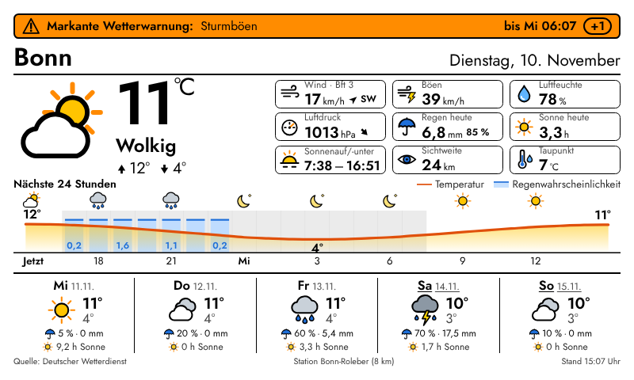
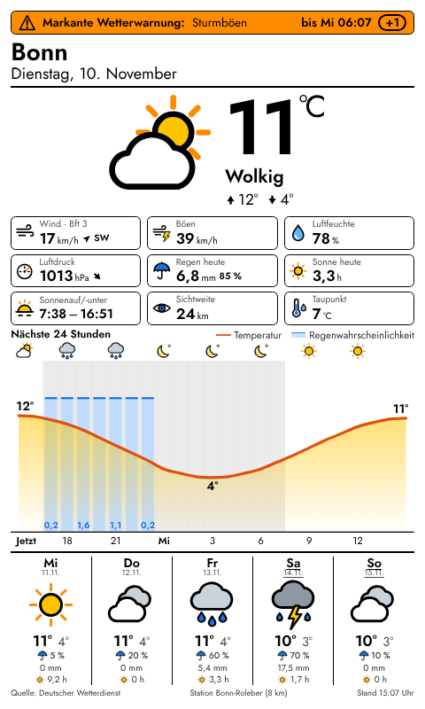

# InkyPi – DWD Wetter

Ein InkyPi-Plugin, das das Wetter auf Deutsch mit offenen Daten des Deutschen Wetterdienstes (DWD) anzeigt: aktuelle Messwerte, amtliche Warnungen, Stundenverlauf und Mehrtagesvorhersage.




*Die Screenshots zeigen simulierte Testdaten.*

## Was angezeigt wird

- **Jetzt:** Temperatur, Wetterlage in DWD-Begriffen (heiter, wolkig, bedeckt, Regenschauer …), Tageshöchst- und Tiefstwert, gefühlte Temperatur (Windchill bzw. Hitzeindex)
- **Messwert-Kacheln** (einzeln abschaltbar): Wind mit Beaufort und Richtung, Böen, Luftfeuchte, Luftdruck mit 3-Stunden-Tendenz, Niederschlag heute (Menge und Wahrscheinlichkeit), Sonnenstunden heute, Sonnenauf- und -untergang, Sichtweite, Taupunkt, Bewölkung
- **Amtliche DWD-Warnungen** für die Gemeinde, eingefärbt nach DWD-Warnstufe (gelb, orange, rot, violett)
- **Stundenverlauf** für 12–48 Stunden: Temperaturkurve, Regenwahrscheinlichkeit, Regenmengen, Wettersymbole und grau hinterlegte Nachtstunden
- **Vorhersage** für 3–7 Tage: Symbol, Höchst- und Tiefstwert, Regenwahrscheinlichkeit, Regenmenge, Sonnenstunden
- Ein **eigenes Iconset** als Inline-SVG mit kräftigen Konturen, damit es auf E-Ink gut lesbar bleibt. Die Konturen übernehmen die Textfarbe aus den Stileinstellungen.
- Das Layout funktioniert im Quer- und Hochformat und skaliert mit der Auflösung (getestet mit 600×448, 800×480, 480×800 und 1600×1200).

## Installation

Mit der InkyPi-CLI, sobald das Repository auf GitHub liegt:

```bash
inkypi plugin install dwd_wetter https://github.com/<dein-name>/InkyPi-DWD-Wetter
```

Oder von Hand:

```bash
cp -r dwd_wetter ~/InkyPi/src/plugins/
sudo systemctl restart inkypi.service
```

Danach erscheint **DWD Wetter** in der Web-Oberfläche. Ort suchen (oder auf der Karte wählen), speichern, fertig. Zusätzliche Python-Pakete braucht das Plugin nicht: `requests` und `astral` bringt InkyPi schon mit.

**Empfohlenes Aktualisierungsintervall:** 30–60 Minuten. Der DWD aktualisiert die Messwerte etwa halbstündlich und die MOSMIX-Vorhersage stündlich.

## Datenquelle

| | |
|---|---|
| API | [Bright Sky](https://brightsky.dev) – freie JSON-API für die Open Data des DWD ([Doku](https://brightsky.dev/docs/)) |
| API-Key | nicht nötig |
| Kosten/Limits | kostenlos; bitte nicht öfter als nötig abfragen |
| Endpunkte | `/current_weather` (Stationsmessungen), `/weather` (Beobachtungen und MOSMIX-Vorhersage), `/alerts` (Warnungen) |
| Nutzungsbedingungen | Es gelten die [Nutzungsbedingungen des DWD](https://www.dwd.de/EN/service/legal_notice/legal_notice.html); die Quellenangabe steht in der Fußzeile. |
| Abdeckung | Deutschland und grenznahe Orte. Die aktuellen Messwerte kommen von der nächstgelegenen DWD-Station (bis 50 km). |

Sonnenauf- und -untergang werden lokal mit `astral` berechnet. Die Ortssuche in den Einstellungen nutzt OpenStreetMap/Nominatim und läuft nur im Browser.

Fällt die Station aus, nimmt das Plugin die Werte aus der Vorhersage für die aktuelle Stunde. Sind die Warnungen nicht erreichbar, wird das Bild trotzdem erzeugt.

## Aufbau

```
dwd_wetter/
├── dwd_wetter.py        # Datenabruf, Aufbereitung, Tageswerte, Stundengraph
├── dwd_icons.py         # SVG-Iconset (Wetter- und Messwert-Symbole)
├── settings.html        # Einstellungsseite (deutsch)
├── plugin-info.json
├── icon.png
└── render/
    ├── dwd_wetter.html  # Jinja-Template
    └── dwd_wetter.css   # Layout, skaliert über die CSS-Variable --u
```

## Status

Version 1.0. Wird aktiv gepflegt; Fehlerberichte und Pull Requests sind willkommen.

Lizenz: GPL-3.0 (wie InkyPi).
